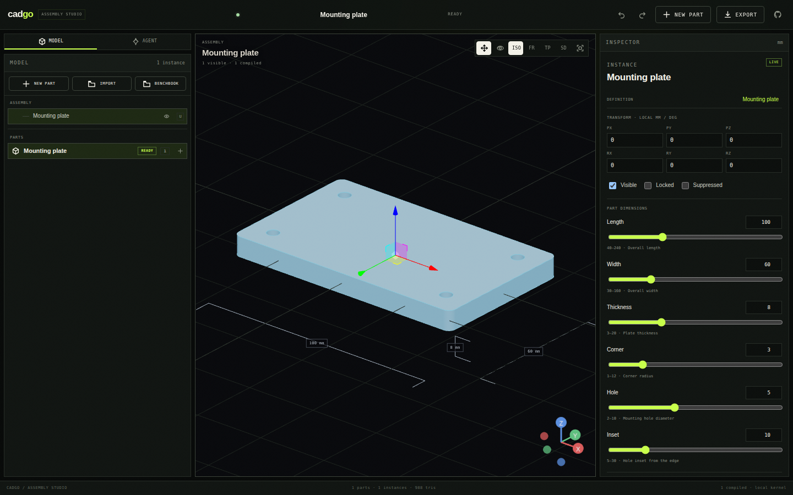
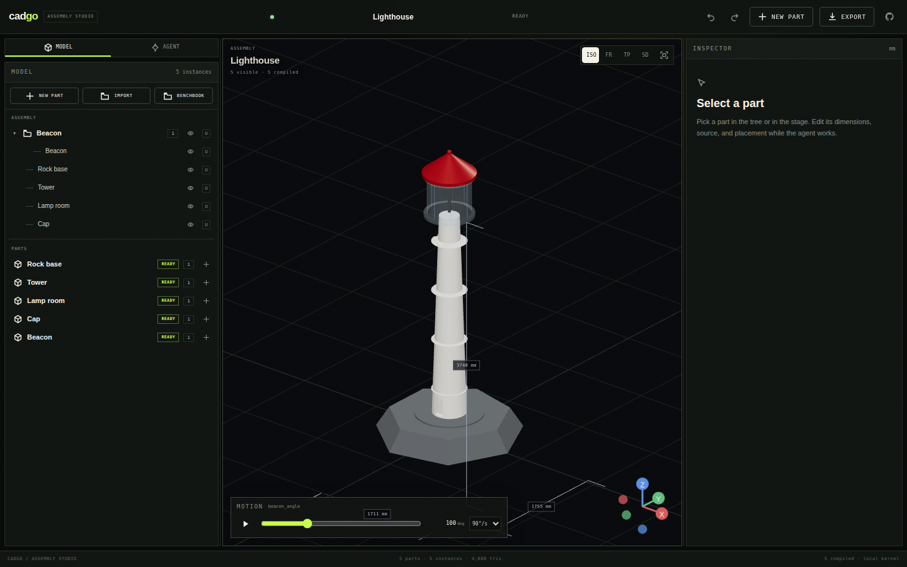
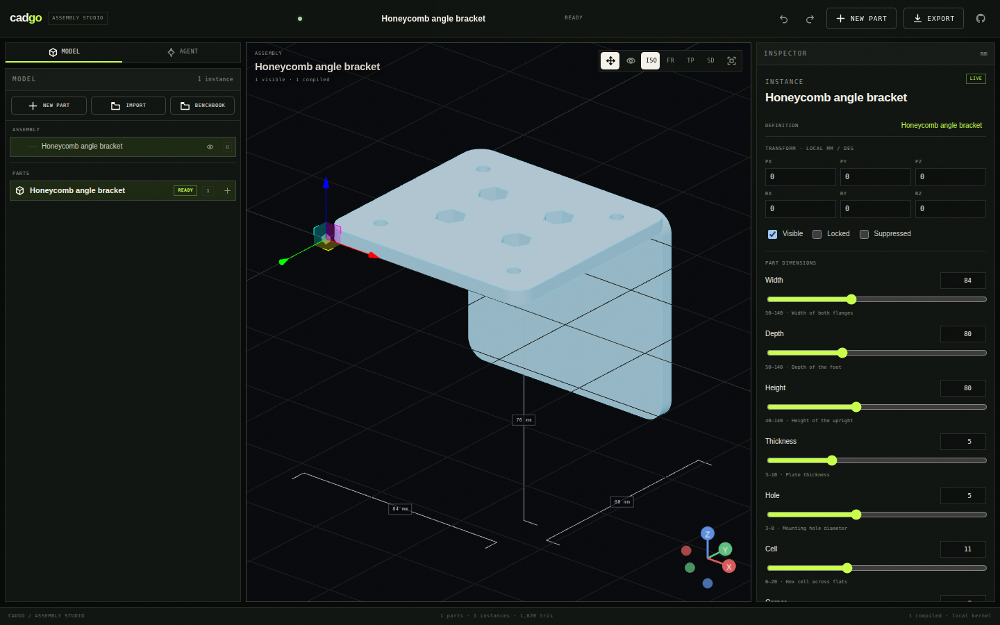

# Cadgo

**Describe a part or scene. Get editable 3D.**

Cadgo is a browser-based AI 3D assembly studio for mechanical assemblies and concept 3D scenes. A plain-language brief becomes a parametric assembly graph — reusable OpenSCAD definitions, placed instances, groups, joints and drivers. Every part compiles locally with the OpenSCAD WebAssembly kernel, and you can edit a part’s dimensions, source or placement while the agent works on another; material overrides are set through the agent or the source.

CAD-grade parametric editing stays the core: named dimensions, editable source, separate bodies and standard exports.

**Live demo:** https://cadgo-v2.vercel.app/studio  
**Repository:** https://github.com/bolajiev/cadgo  
**Hackathon:** Victoria VR AI Builder Hackathon 2026 · **AI-assisted 3D editing**





## What it does

- **Prompt → parametric assembly.** The agent writes OpenSCAD, the browser compiles it locally, and the dimensions appear as editable parameters. The same graph holds mechanical parts and concept scenes.
- **One scope, two modes.** Mechanical assemblies and concept 3D scenes share groups, definitions, instances, joints and drivers. A bracket, a mechanism study and a concept scene use the same document model; there is no separate scene fork.
- **Edit while the agent works.** The tree, stage and inspector stay live during an agent run. Select a part, change a dimension, move it, hide it, lock it, or edit its source. Every change is an immutable command with undo/redo.
- **Demo.** `docs/cadgo-demo.mp4` is a 1:21 screen cut; `DEMO_SCRIPT.md` has the narration, shot list and prompt cards.
- **Streaming, readable agent chat.** Replies stream token by token and render Markdown: bold, lists, inline code and fenced OpenSCAD blocks. If the model hits its output limit, the agent automatically continues in smaller steps instead of stopping. For humanoids, it models a mechanical robot with limb groups and joints, not a person.
- **Assembly tree.** Groups, definitions, instances, visibility, locking, suppression and transforms. Select in the tree or in 3D.
- **Real CAD interaction.** Orthographic view, standard views, axis gizmo, overall dimension lines, translate/rotate gizmo, isolate, and a per-part property inspector.
- **Per-part revisions and conflicts.** Every agent mutation carries the revision it read. If you changed the same part first, your edit wins and the agent receives a conflict to re-read and rebase.
- **Per-instance overrides.** Change a parameter on one placed instance and it compiles a separate variant; the shared definition stays untouched.
- **Material editing.** Source-colour and material-override modes, with colour, metalness, roughness and opacity per definition or instance.
- **Local compile pool.** Two OpenSCAD WASM workers compile definitions in parallel; variants are cached by source + parameter hash. Failed parts keep the last good mesh and expose the compiler log.
- **Image and print setup.** Attach up to three reference views; set purpose, printer, bed, material and supports. The print profile travels with the prompt and gates STL export on bed overflow.
- **Inspection.** The agent requests orthographic views; the browser renders the assembly and returns it to the model as vision evidence.
- **Motion.** Joints and drivers are the working logic for mechanisms and scenes: expression-driven revolute/prismatic/link joints, with a whole group as the joint target so a rotor or fan spins intact without separating its blades. Concept labs include a V8 and a transparent rotary mechanism.
- **Export and import.** Exports are assembly STL, a Scene GLB with the group hierarchy, resolved materials and driver animation clips, a Part STLs ZIP (one transformed STL per visible instance plus the merged assembly), a ZIP with one editable SCAD per definition plus the assembly manifest and native document, `.cadgo.json`, and compressed share links. Import `.scad` as a new part or `.cadgo.json` to restore a complete assembly.
- **Benchbook.** A mounting plate, honeycomb angle bracket, knurled knob and spur gear, all fully parametric. Concept labs add a driven wind turbine, a lighthouse scene, the V8, a transparent rotary mechanism and a phase-driven humanoid walk cycle. A narration/shot script for the demo is in `DEMO_SCRIPT.md`.



## How it works

```
prompt / image / print setup ──► DeepSeek V4.1 Flash agent
                                  │
                 create/update definition, instance, group, joint
                                  ▼
                        immutable assembly document
                                  │
                                  ▼
              per-definition OpenSCAD WASM compile
              (worker pool · hash cache · metrics)
                                  │
                                  ▼
       three.js assembly · selection · motion · inspection
                                  │
                                  ▼
       STL · Scene GLB · Part STLs ZIP · SCAD + manifest ZIP · .cadgo.json · share
```

The server is a model proxy. It never executes geometry. OpenSCAD runs in a browser module worker; the document autosaves to IndexedDB and exports explicitly. The only server-side document path is the optional large-share store, which holds a compressed share payload, not geometry.

## Run locally

```sh
npm install
cp .env.example .env.local
# add OPENCODE_GO_API_KEY
npm run dev
```

Open `http://localhost:3000/studio`. The root redirects to the studio.

| variable | default | purpose |
|---|---|---|
| `OPENCODE_GO_API_KEY` | — | server-side key; never sent to the browser |
| `OPENCODE_GO_BASE_URL` | `https://opencode.ai/zen/go/v1` | OpenAI-compatible endpoint |
| `OPENCODE_GO_DESIGN_MODEL` | `deepseek-v4.1-flash` | agent and vision model |
| `CADGO_AGENT_MAX_TOKENS` | `24000` | agent output cap |
| `CADGO_AGENT_UPSTREAM_TIMEOUT_MS` | `240000` | upstream model request timeout |
| `CADGO_AGENT_RATE_LIMIT` | `200` | per-session agent requests per window; `0` disables |
| `CADGO_AGENT_RATE_WINDOW_MS` | `3600000` | rate-limit window |
| `CADGO_AGENT_IP_RATE_LIMIT` | `1000` | per-IP agent requests per window across sessions; `0` disables |
| `UPSTASH_REDIS_REST_URL` | — | optional durable rate-limit store; Vercel KV's `KV_REST_API_URL` also works |
| `UPSTASH_REDIS_REST_TOKEN` | — | token for the durable rate-limit store; Vercel KV's `KV_REST_API_TOKEN` also works |
| `BLOB_READ_WRITE_TOKEN` | — | optional large-share storage |
| `CADGO_SHARE_DIR` | `.data/shares` | local large-share directory outside Vercel |
| `CADGO_SHARE_TTL_DAYS` | `30` | large-share expiry |

`CADGO_AGENT_RATE_LIMIT` is enforced per agent session; `CADGO_AGENT_IP_RATE_LIMIT` caps requests per IP so new sessions cannot bypass the budget. Without `UPSTASH_REDIS_REST_URL` the limiter is in-process (fine for local use and one instance); a multi-instance deployment should set the durable store.

### Checks

```sh
npm test                 # document, compile, audit, motion and bundle tests
npm run test:e2e         # build + Playwright smoke and stage snapshot on :3100
npm run typecheck
npm run build
```

## Try this

1. Open `/studio`; choose **Benchbook → Mounting plate**.
2. Click the part in the tree or stage; drag a **Part dimensions** slider and watch the local rebuild.
3. Use the translate/rotate gizmo, isolate the part, and undo the edit.
4. Open the **Agent** tab and ask: *“Add a 6 mm hole and make the plate 5 mm thick.”* Edit another part while it works.
5. Attach reference views and open **Print setup**; the profile goes with the next agent message and gates STL export.
6. Import a `.scad` as a new part, or import a previously exported `.cadgo.json`.
7. Open **Export** for assembly STL, Scene GLB, Part STLs, the SCAD ZIP bundle, the Cadgo document or a share link.
8. Optional: **Benchbook → Concept labs** for the wind turbine, lighthouse scene, V8 and transparent rotary mechanism.

## Limits

- Concept CAD and concept 3D scenes, not certified engineering: no B-Rep, STEP, tolerances, mating constraints or manufacturing validation.
- Concept scenes are for visualization and motion studies: no physics, gameplay, animation timeline or scene scripting.
- The Scene GLB includes a clip per driver when drivers exist; it is a scene export, not a full animation timeline. A scene with no drivers exports static.
- OpenSCAD is a mesh/CSG kernel; organic surfaces and tight fits are approximations.
- The V8 and rotary studies are concept labs, not manufacturable engines.
- Up to three reference views; no camera calibration, crop/rotate or photogrammetry.
- No account or cloud project database. Documents autosave locally; an optional Blob/local store backs large share links.

## Judging alignment

- **Impact:** an editable starting point for hardware teams, makers, educators and creators building concept 3D scenes, with real source, named dimensions and standard exports.
- **Generalizability:** any OpenSCAD source becomes a definition; the unified assembly graph, revision model, compile pool and agent tools are not tied to the benchbook. The same joints, drivers and material overrides work for mechanical assemblies and scenes, so the product is not limited to CAD demos.
- **Technical depth:** local OpenSCAD WASM pool, per-variant hashing, progressive compile, immutable commands, per-node optimistic concurrency, explicit material overrides, expression-driven motion, inspection and export.
- **Demo quality:** blank start, agent-assisted part or scene creation, live parameter/source editing, assembly tree, dimensions/gizmo, motion labs and one-click STL, Scene GLB, Part STLs, SCAD and JSON export.

## Built with

Next.js 16, React 19, React Three Fiber, three.js, OpenSCAD WebAssembly, Zustand, Zod, Vitest, Playwright, Vercel. The design engine uses an OpenAI-compatible endpoint (DeepSeek V4.1 Flash via OpenCode Go).

The OpenSCAD WASM distribution and its source offer come from CADAM; see [THIRD_PARTY.md](THIRD_PARTY.md). The drafting visual system is informed by the Anatomy skill.

## License

**GPL-3.0.** The app distributes the OpenSCAD WebAssembly build, which is GPL-2.0-or-later; the combined distribution is GPL-3.0. See [LICENSE](LICENSE) and `public/openscad/SOURCE-OFFER.txt`.

## Submission

- [Written submission](SUBMISSION.md)
- Category: **AI-assisted 3D editing**
