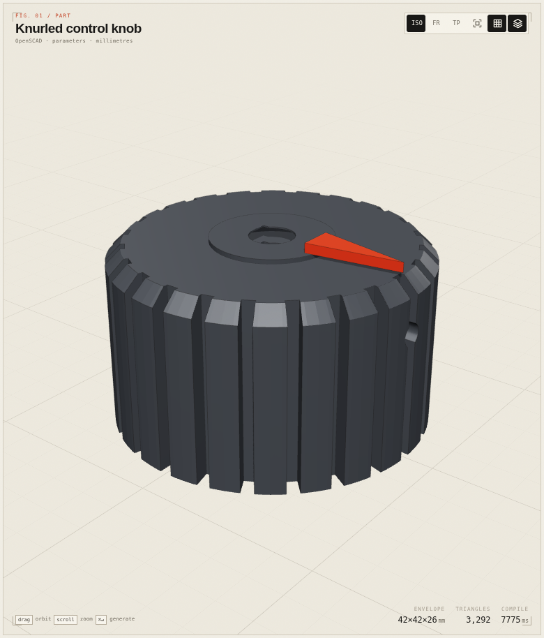
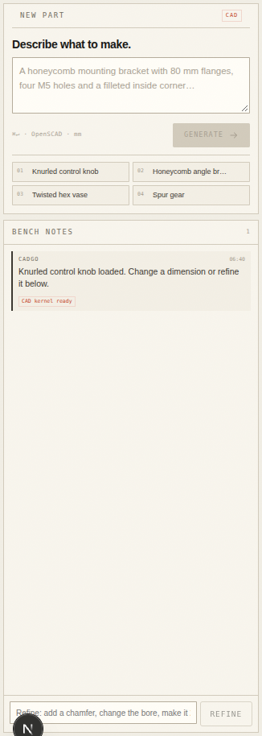

# Cadgo

**Describe a part. Get real CAD.**

Cadgo is a browser-based AI CAD workbench. A plain-language brief becomes editable **OpenSCAD** source, compiled locally with the OpenSCAD WebAssembly kernel. Parameters rebuild in the browser, the source is visible and editable, and every model exports as STL or SCAD.

**Live demo:** https://cadgo.vercel.app  
**Repository:** https://github.com/bolajiev/cadgo  
**Hackathon:** Victoria VR AI Builder Hackathon 2026 · **AI-assisted 3D editing**

The app opens on a **blank new part** — no hardcoded preview. **New page** opens another blank studio in a new tab.



## What it does

- **Prompt → parametric CAD.** Write “a 100 × 60 × 8 mm mounting plate with four 5 mm corner holes and rounded corners.” Cadgo writes OpenSCAD, compiles it in the browser, and exposes its dimensions as sliders.
- **Chat to edit.** Reply in the same thread; the agent revises the current source instead of starting over. The reply reports how many lines changed.
- **Local parameter rebuilds.** Move a slider and the model recompiles in the browser. No AI round-trip, no server geometry.
- **Compiler repair.** If generated code does not compile, the compiler log goes back to the model for a fix. Detached floating solids are detected and repaired too.
- **Optional web lookup.** For a named standard component where an exact size is missing, the agent can search Wikipedia or fetch an authoritative public page, and must cite it; otherwise it states its assumption.
- **Editable source.** The source tab shows and edits the actual OpenSCAD. Download the `.scad` or the `.stl`.
- **Fast fallback.** DeepSeek V4.1 Flash is the default design compiler; a GLM-5.3 Flash fast pass can answer first when the primary is slow. The compiler error loop is the quality gate.
- **Benchbook.** A knurled knob, honeycomb bracket, twisted vase and spur gear load instantly and stay fully parametric.



## Why it matters

CAD is still expert software. AI 3D tools usually return a pretty mesh that cannot be dimensioned, edited or manufactured. Cadgo returns the thing a hardware team actually needs: **editable source, named dimensions, a local kernel and a manufacturable export**.

- **Who benefits:** hardware teams prototyping fixtures and brackets, makers without CAD training, educators teaching parametric design, and engineers who want a fast first draft they can take into their real toolchain.
- **Why now:** browser WebAssembly makes a real CAD kernel local and private; LLMs are now good at writing OpenSCAD; the missing piece was a reliable design-spec → compile → repair loop. That is what Cadgo adds.
- **Adoption path:** the output is standard `.scad` and `.stl`, not proprietary state. A team can adopt it beside an existing CAD workflow on day one.

## Beyond the demo

The engine is not tied to the four studies.

- **Bring your own source:** import any `.scad`; top-level dimensions become sliders immediately.
- **Bring your own data:** the OpenSCAD source is visible and editable; the generated program is the artifact, not hidden model state.
- **Reusable compiler loop:** the same parameter extractor, compiler-error repair, floating-solid check and local worker can sit behind any CAD UI, API or classroom tool.
- **Any part, not one niche:** the benchbook spans a knob, a bracket, a vase and a gear; the prompt path is not limited to those categories.
- **Export:** `.stl` for printing and `.scad` for the source; no lock-in.

## How it works

```
brief ──► DeepSeek V4.1 Flash ──► OpenSCAD source ──► local OpenSCAD WASM compile
              │   (GLM fast pass)                         │
              │                                            ├─ mesh + colours
              └─► compiler log / detached-part repair ◄────┘
                                                           │
                                             parameters ◄──┤
                                                           └──► STL / SCAD / share
```

The model writes a data-only OpenSCAD program through a tool call. The server never compiles or executes it; the browser does, in a module worker. Parameters are top-level Customizer variables:

```scad
// Overall diameter
diameter = 42; // [24:70]
```

Changing a slider rewrites that value in the source and recompiles locally. The source and the sliders can never disagree.

## Run locally

```sh
npm install
cp .env.example .env.local
# add OPENCODE_GO_API_KEY
npm run dev
```

Open `http://localhost:3000`. The part studio is `/` and starts on a blank new part — no starter model. Use **New page** or the empty-state button to open a fresh studio in a new tab.

| variable | default | purpose |
|---|---|---|
| `OPENCODE_GO_API_KEY` | — | server-side key; never sent to the browser |
| `OPENCODE_GO_BASE_URL` | `https://opencode.ai/zen/go/v1` | OpenAI-compatible endpoint |
| `OPENCODE_GO_MODEL` | `deepseek-v4.1-flash` | primary design compiler |
| `OPENCODE_GO_FALLBACK_MODEL` | `glm-5.3-flash` | fast parallel pass / fallback |

### Checks

```sh
npm test                 # expression, schema, pose and OpenSCAD parameter tests
npm run typecheck
npm run build
```

## Try this

1. Load the **Knurled control knob** and drag *Overall diameter* / *Height*.
2. Open **OpenSCAD** and read the source; click *Edit code* and compile a change.
3. Prompt: **“A honeycomb angle bracket with 90 mm flanges, 5 mm plate, four M5 holes and rounded corners.”**
4. Download **STL** and **SCAD** from Export.
5. Use **Import .scad** to bring an existing OpenSCAD source; its dimensions become sliders.
6. Use **New page** to open a blank studio in a new tab.

The app opens blank. Loading a bench study or generating a part is an explicit action; the examples are complete OpenSCAD programs, not cached screenshots, and every parameter is live.

## Limits

- The part studio exports **STL and SCAD**; it is a mesh/OpenSCAD workflow, not a STEP/B-rep kernel.
- The AI can produce a weak design. The compiler, the detached-solid check and the repair loop catch structural failures, not every bad engineering decision.
- OpenSCAD WASM is a ~9 MB first load. It is cached by the browser; the first compile wakes it.
- No account or cloud project database. Share links carry the source in the URL fragment.

## Judging alignment

- **Impact (30%):** turns natural language into an editable, exportable CAD starting point for hardware teams, makers and educators; standard STL/SCAD output fits existing workflows.
- **Generalizability (25%):** OpenSCAD import, source-preserving parameter extraction and a reusable compile/repair engine apply to arbitrary parametric parts, not just the benchbook.
- **Technical depth (20%):** local OpenSCAD WebAssembly kernel, module worker, parameter extraction, compiler repair, floating-solid detection, deterministic local rebuilds, binary STL writer, SSRF-guarded reference lookup, tests.
- **Demo quality (25%):** blank new-part start, opt-in benchbook, one-screen chat → model → parameters → source → export; the chat edits the current part; the shot list is in [VIDEO.md](VIDEO.md).

## Built with

Next.js 16, React 19, React Three Fiber, three.js, **OpenSCAD WebAssembly**, Zustand, Zod, Vercel. The design compiler uses an OpenAI-compatible endpoint (DeepSeek V4.1 Flash / GLM-5.3 Flash via OpenCode Go).

The paper-and-ink plate language was informed by the [Anatomy](https://github.com/wheresryan22/anatomy) craft rules. The OpenSCAD WASM distribution and its source offer come from [CADAM](https://github.com/Adam-CAD/CADAM); see [THIRD_PARTY.md](THIRD_PARTY.md).

## License

**GPL-3.0.** The app distributes the OpenSCAD WebAssembly build, which is GPL-2.0-or-later; the combined distribution is GPL-3.0. See [LICENSE](LICENSE) and `public/openscad/SOURCE-OFFER.txt`.

## Submission

- [Demo video script](VIDEO.md)
- [Written submission](SUBMISSION.md)
- Category: **AI-assisted 3D editing**
