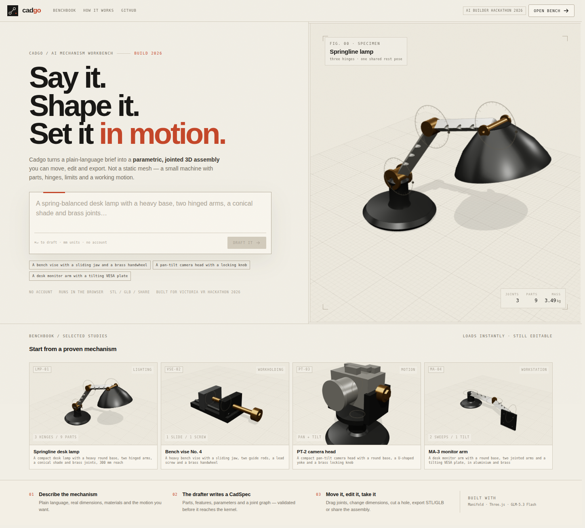
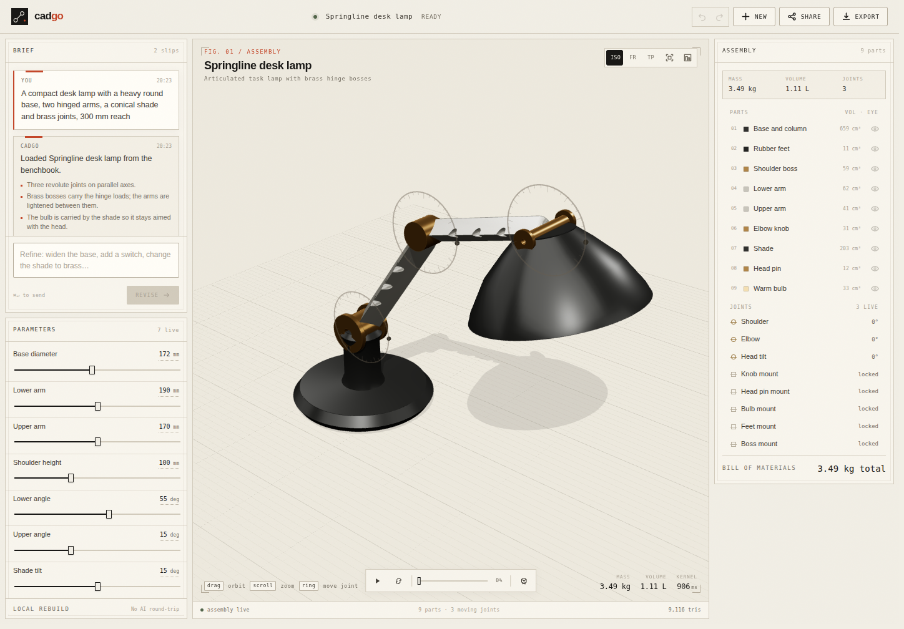
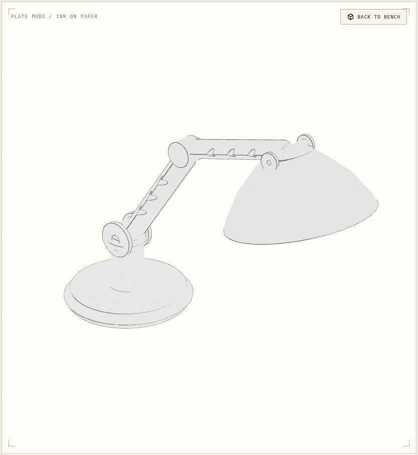

# Cadgo

**Say it. Shape it. Set it in motion.**

Cadgo is a browser-based AI mechanism workbench. Describe a functional object in plain language and it drafts a **parametric, jointed 3D assembly** you can move, edit and export — not a static mesh.

Built for the **Victoria VR AI Builder Hackathon 2026** (category: AI-assisted 3D editing).

**Live demo:** https://cadgo.vercel.app  
**Repository:** https://github.com/bolajiev/cadgo



## What it does

- **Prompt → mechanism.** A brief becomes named parts, millimetre dimensions, materials, a joint graph with limits, and a demo motion.
- **Working logic, not decoration.** Revolute and prismatic joints move real parts. Drag a joint ring, scrub the timeline, play the fold, or explode the assembly.
- **Editable after generation.** Parameter sliders rebuild locally. Conversational refinements revise the spec. Click a face to cut a real hole without another AI round-trip.
- **A real CAD pipeline.** Watertight solids from the Manifold kernel, per-part volume and mass, a bill of materials, and STL / GLB / CadSpec exports.
- **A drafting plate.** Plate mode draws an ink-on-paper orthographic study with a title block, rendered from the actual model.
- **Four proven studies.** A springline lamp, a bench vise, a pan-tilt camera head and a monitor arm load instantly from the benchbook.





## How it works

```
plain-language brief
        │
        ▼
LLM design compiler ──► CadSpec (parts as CSG, parameters, joints, demo)
        │                 │
        │                 ├─ Zod schema + graph checks + JSON repair
        │                 └─ repair loop / curated fallback
        ▼
manifold-3d worker ──► watertight meshes • volume • mass • triangles
        │
        ▼
joint solver ──► posed matrices • joint gizmos • motion timeline
        │
        ▼
React Three Fiber scene ──► STL / GLB / plate PNG / share URL
```

The model is **GLM-5.3 Flash** through OpenCode Go, with **DeepSeek V4.1 Flash** as a fallback. The LLM writes a data-only `CadSpec` — never executable code. A deterministic compiler turns that spec into geometry; if a draft does not validate or build, Cadgo repairs it and then falls back to a curated study rather than leaving a blank bench.

Every generated model keeps:

- named parts with materials and expressions (`arm_len * 0.6`);
- a CSG tree per part (boxes, cylinders, revolves, extrusions, patterns, booleans);
- world-space joints with axes, limits and rest values;
- a demo keyframe sequence;
- design notes and a BOM.

The core is in [`lib/cad`](lib/cad): [`types.ts`](lib/cad/types.ts), [`engine.ts`](lib/cad/engine.ts), [`pose.ts`](lib/cad/pose.ts), [`validate.ts`](lib/cad/validate.ts). The AI provider and prompts are in [`lib/ai`](lib/ai).

## Run locally

```sh
npm install
cp .env.example .env.local
# put your OpenCode Go key in OPENCODE_GO_API_KEY
npm run dev
```

Open `http://localhost:3000`.

Environment:

| variable | default | purpose |
|---|---|---|
| `OPENCODE_GO_API_KEY` | — | server-side key; never sent to the browser |
| `OPENCODE_GO_BASE_URL` | `https://opencode.ai/zen/go/v1` | OpenAI-compatible endpoint |
| `OPENCODE_GO_MODEL` | `glm-5.3-flash` | primary design compiler |
| `OPENCODE_GO_FALLBACK_MODEL` | `deepseek-v4.1-flash` | second pass on failure |

The key is used only in `app/api/generate` and `app/api/edit`, with per-IP rate limits and a token cap. The demo also works from the four local benchbook studies if the drafter is unavailable.

### Checks

```sh
npm test                 # expression, schema and pose-solver tests
npm run check:examples   # compile all four studies through Manifold
npm run typecheck
npm run build
```

## Demo

Open **https://cadgo.vercel.app**, type a brief, or load one of the four benchbook studies. The first live draft uses a large model and usually takes 20–50 seconds; the benchbook is instant and every study remains fully editable.

## Try this

1. **Springline lamp** — drag the shoulder ring, press play, then change *Upper arm*.
2. **Bench vise** — press play to close the jaw; select *Lead screw* and drag its slider.
3. **PT-2 camera head** — pan and tilt; orbit to see the yoke and axle.
4. **Conversational edit** — load the lamp and ask: *“Widen the base 20% and add a cable hole at the back.”*
5. **Plate** — press the plate icon, then use **Export → Plate PNG**.

If a live draft is slow, the loading card offers a proven bench study. The live drafter keeps the same spec pipeline, so the study is still fully editable.

## Limitations

- The kernel is a **mesh** kernel (Manifold), not a B-rep kernel. Exports are STL/GLB, not STEP.
- AI drafts can be mechanically imperfect. The schema, graph validation and repair loop catch structural failures; they do not guarantee a manufacturable design.
- There is no authentication or cloud project storage. Recent projects are stored in the browser with IndexedDB; share links carry the spec in the URL fragment.
- Generated assemblies are capped at 14 parts and 14 joints to keep the demo responsive.

## Built with

Next.js 16, React 19, React Three Fiber, three.js, manifold-3d, Zustand, Zod, Vercel, and an OpenAI-compatible model endpoint (GLM-5.3 Flash / DeepSeek V4.1 Flash via OpenCode Go).

The visual system — paper-and-ink plates, technical frames, ruler-marked readouts — was designed with the [Anatomy](https://github.com/wheresryan22/anatomy) craft rules in mind. The hero and study images are renders of Cadgo's own models. Third-party licenses are listed in [THIRD_PARTY.md](THIRD_PARTY.md).

## Submission

- [Demo video script](VIDEO.md)
- [Written submission](SUBMISSION.md)
- Category: **AI-assisted 3D editing**
